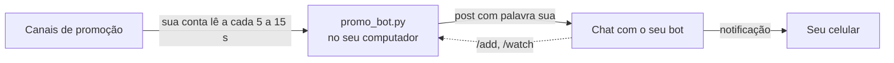

# promo-bot

Um bot de Telegram que lê canais de promoção por você e só te chama quando aparece o que você procura.

## O problema

Canal de promoção posta o dia inteiro. Com a notificação ligada, o celular não para. Silenciado, você vê a promoção do jogo que queria três horas depois, quando já acabou.

Com o promo-bot você silencia os canais e diz pro bot o que procura. Quando um post bate, ele te encaminha a mensagem original, com foto, link e o nome do canal, poucos segundos depois de ela ser postada.

## Como é usar

Tudo é pelo chat com o seu bot. Pra vigiar um canal e duas palavras:

```
/watch https://t.me/exemplo_jogos jogos
/add three houses, pokopia
```

Pronto. Todo post desse canal que citar Three Houses ou Pokopia chega no seu chat com o bot.

Dá pra separar as palavras em grupos e escolher quais canais leem cada grupo. Assim "rtx 4060" só é procurada nos canais de hardware:

```
/add ssd, rtx 4060 #pc
/watch https://t.me/exemplo_hardware hardware #pc
```

| Comando | O que faz |
|---|---|
| `/add three houses` | vigia uma palavra no grupo geral, que todo canal lê |
| `/add ssd, rtx 4060 #pc` | vigia palavras num grupo e cria o grupo se ele não existir |
| `/rm ssd #pc` | para de vigiar uma palavra |
| `/rmgroup #pc` | apaga um grupo |
| `/watch <link> <apelido> #pc` | vigia um canal, os grupos no fim são opcionais |
| `/unwatch <apelido>` | para de vigiar um canal |
| `/link <apelido> #pc` | faz o canal ler mais um grupo, `/unlink` desfaz |
| `/list` | mostra grupos, palavras e canais |

Maiúscula e acento não importam. Palavra com mais de um termo vira frase: `three houses` pega "Three Houses" e "ThreeHouses", mas ignora um post que só fala "Three".

## Como funciona



Bot de Telegram só lê canal onde é admin, e você não é admin dos canais de promoção. Por isso o script loga na sua conta pra ler os canais e deixa só a entrega com o bot. Mensagem que vem do bot gera notificação. Mensagem da sua própria conta não geraria.

O script roda no seu computador, só abre conexões de saída e gasta uns 50 MB de RAM.

## O que você precisa

- Um computador Linux que fique ligado. Notebook velho serve, o meu é um i3 com 4 GB que também roda um Jellyfin.
- Python 3.10 ou mais novo.
- `api_id` e `api_hash` do Telegram. Entre em [my.telegram.org](https://my.telegram.org), vá em "API development tools" e crie um app com qualquer nome.
- Um bot. Mande `/newbot` pro [@BotFather](https://t.me/BotFather) e guarde o token.
- Uns 10 minutos.

## Instalação

Recomendo pedir pra um agente de IA fazer. Abra o Claude Code, o Codex ou o que você usar dentro da pasta do repositório e peça:

> Instala o promo-bot nesta máquina seguindo o AGENTS.md.

O [AGENTS.md](AGENTS.md) explica pro agente como instalar, como o código funciona e o que ele não pode fazer. No fim ele te pede pra rodar um comando no seu terminal. Esse comando pede as credenciais, o seu telefone e o código de login que chega no Telegram. Essa parte fica com você de propósito, assim token e código não passam pelo chat com a IA.

<details>
<summary>Prefiro instalar na mão</summary>

```bash
git clone <url-deste-repo> ~/promo-bot && cd ~/promo-bot
python3 -m venv venv && venv/bin/pip install -r requirements.txt
mkdir -p ~/.config/systemd/user && cp promo-bot.service ~/.config/systemd/user/
systemctl --user daemon-reload
loginctl enable-linger                 # faz o bot subir no boot, pode pedir sudo
venv/bin/python promo_bot.py setup     # login interativo, liga o serviço no fim
```

Depois mande `/help` pro seu bot.

</details>

## Cuidados

- Os arquivos `.session` são o login da sua conta. Quem copiar eles entra no seu Telegram. O `.gitignore` já deixa eles fora do git, junto com o `.env`.
- Não rode o mesmo login em duas máquinas ao mesmo tempo. O Telegram derruba a sessão e você precisa refazer o setup.
- Usar a sua conta num script tem algum risco de bloqueio. O bot tenta ser discreto. Ele só lê e encaminha mensagens pra você mesmo, checa os canais a cada 5 a 15 segundos com intervalo sorteado e desacelera quando o Telegram pede. Se o login cair, ele te avisa no chat.
